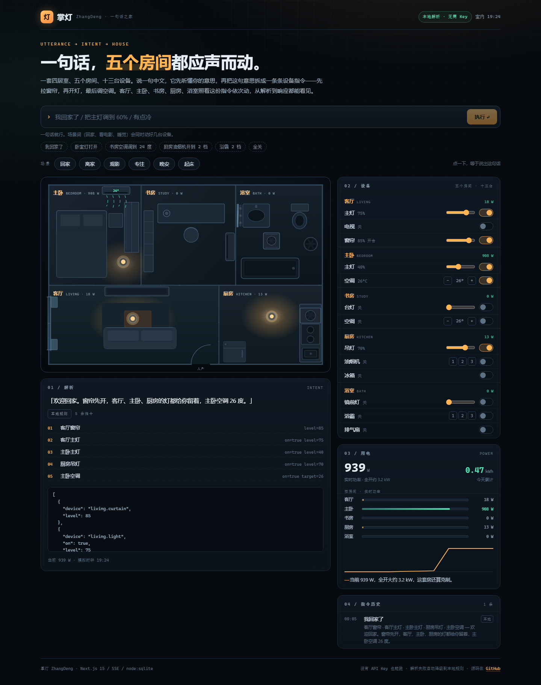

# 掌灯 ZhangDeng · 一句话之家

> 对着屋子说一句中文，它先听懂，再把这句话拆成一条条设备指令，一台一台地动给你看。



一个能完整跑通的 AI 全栈小项目：**自然语言 → 结构化意图 → 设备动作 → 实时画面与用电**。
没有 API Key 也能从第一秒开始用（本地规则引擎），配了大模型就换成 LLM 解析，解析失败自动降级回本地。

## 30 秒跑起来

```bash
pnpm install
pnpm dev
# 打开 http://localhost:3100
```

然后在输入框里试这几句：

| 说这句话 | 屋子会做什么 |
| --- | --- |
| `我回家了` | 窗帘拉开 → 主灯 75% → 落地灯 35% → 空调 26° → 风扇 1 档（5 台设备依次响应） |
| `看电影` | 窗帘关 → 主灯关 → 落地灯调到 18% → 电视开 → 空调 24° |
| `把主灯调到 60%` | 只动主灯，亮度 60% |
| `有点冷` | 空调温度上调 2 度 |
| `全关` | 六台设备一次性关掉 |

页面右侧的「01 / 解析」会同时给出：这句话的回应、本地/LLM 引擎标记、拆出来的每条指令，以及原始 JSON。

## 这个项目想证明什么

很多「AI 项目」停在「接个大模型接口」这一步。掌灯把一条链路完整摊开：

1. **输入是模糊的**：一句人话，没有按钮、没有固定语法。
2. **中间必须是结构化的**：解析成 `{ device, on, level, target }` 的数组，前端能看见、能调试、能单测。
3. **执行是有顺序的**：指令一条一条落地，屋子一台一台响应（先拉窗帘，再开灯）。
4. **反馈是实时的**：设备状态通过 SSE 每秒推给前端，功率曲线跟着动。
5. **失败有退路**：LLM 超时、返回坏 JSON、网络断掉，整条链路自动降级到本地规则，功能不残。

这五步分别对应 `lib/intent.ts`、`lib/llm.ts`、`lib/house.ts`、`app/api/events/route.ts`、`app/api/command/route.ts`。

## 架构

```
 浏览器
   │  ① POST /api/command  { text: "看电影" }
   ▼
 app/api/command/route.ts ──────────────┐
   │  ② 有 LLM_API_KEY ?                │ ③ 没有 key 或调用失败
   │     lib/llm.ts → planWithLlm()     │    lib/intent.ts → parseIntent()
   │     失败返回 null ─────────────────┤    （本地规则引擎，纯函数）
   ▼                                    ▼
 lib/house.ts  applyActions()  ←──── 统一成 Plan { actions, reply, engine }
   │  ④ 逐条落地，每条广播一次 state
   ▼
 lib/db.ts  saveCommand()  →  data/zhangdeng.db（node:sqlite）
   │
   ▼
 ⑤ SSE /api/events  →  前端刷新屋子、功率、历史
```

两个引擎的输出是同一个类型 `Plan`，所以上层完全不关心这句话是谁解析的——这条边界是整个项目最重要的一行设计。

## 目录

```
app/
  page.tsx                 前端单页：输入、屋子、面板、SSE 订阅
  globals.css              夜色设计系统（无 Tailwind，手写 CSS）
  api/command/route.ts     POST 一句话 → 解析 → 执行 → 存档
  api/device/route.ts      POST 手动开关某台设备
  api/state/route.ts       GET 当前状态 + 历史 + 场景 + 引擎信息
  api/events/route.ts      SSE：每秒推状态
  api/history/route.ts     GET 最近指令
components/
  RoomView.tsx             手写 SVG 客厅：窗帘开合、吊灯灯光、电视辉光、风扇旋转、空调气流
  CommandBar.tsx           一句话输入框 + 示例
  IntentCard.tsx           解析结果：指令列表 + 原始 JSON
  DevicePanel.tsx          六台设备的开关/滑杆/档位/温度
  EnergyPanel.tsx          实时功率、今日用电、sparkline、省电建议
  SceneBar.tsx             场景按钮
  LogPanel.tsx             指令历史
lib/
  intent.ts                本地意图解析（设备别名、场景、百分比、档位、冷热）
  llm.ts                   OpenAI 兼容接口 + zod 校验 + 15s 超时
  house.ts                 屋子状态机、功率模型、广播
  devices.ts / scenes.ts   六台设备与六个场景的定义
  advice.ts                用电建议规则
  db.ts                    node:sqlite 存档
tests/                     20 个 vitest 用例：解析 / 状态机 / 建议
scripts/shot.mjs           用 CDP 驱动 Edge 截图（README 里这张图就是它拍的）
```

## 意图解析：本地引擎怎么工作

`parseIntent(text, state)` 是纯函数，按固定顺序匹配，越具体越优先：

1. **场景词**：`回家`、`看电影`、`睡觉`、`起床`、`离家`、`专注` → 一次展开成多条指令
2. **全关**：`全关`、`都关掉`、`关掉所有` → 六台设备一起关
3. **指定设备 + 参数**：百分比（`60%` / `六成`）、温度（`26 度` / `24℃`）、档位（`三档`）、亮度增减（`调暗` / `调亮`）
4. **体感兜底**：`太亮` / `太暗` / `有点冷` / `有点热` → 对应的灯或空调微调
5. **听不懂**：不动任何设备，但一定给一句回应，并提示可以怎么说

设备识别用别名表匹配（`主灯`、`吸顶灯`、`吊灯` → `light.ceiling`），长别名优先，避免「落地灯」被「灯」抢走。

## LLM 引擎

配了 `LLM_API_KEY` 后，`/api/command` 会先用大模型解析：

- `response_format: json_object`，要求返回 `{ actions, reply }`
- 用 zod 再校验一遍（动作条数、设备 id、参数范围），**不合规直接当失败**
- 15 秒超时；任何一步失败都返回 `null`，上层无缝降级到本地规则
- 返回里的 `engine` 字段会告诉前端这句话到底是谁解析的（页面上有 `本地规则` / `大模型解析` 徽章）

## API

| 方法 | 路径 | 说明 |
| --- | --- | --- |
| POST | `/api/command` | `{ text }` → `{ id, reply, actions, engine, saved, state }` |
| POST | `/api/device` | `{ id, on?, level?, target? }` → `{ state }` |
| GET | `/api/state` | `{ state, history, scenes, engine }` |
| GET | `/api/events` | SSE，每秒 `snapshot` / `state` 事件 |
| GET | `/api/history` | 最近 10 条指令 |

## 环境变量

| 变量 | 默认值 | 说明 |
| --- | --- | --- |
| `LLM_API_KEY` | 空 | 不填就走本地规则引擎，功能完整 |
| `LLM_BASE_URL` | `https://api.deepseek.com/v1` | 任何 OpenAI 兼容接口都行 |
| `LLM_MODEL` | `deepseek-chat` | 例如 `gpt-4o-mini`、`qwen-plus` |
| `ZHANGDENG_DB` | `data/zhangdeng.db` | SQLite 文件位置 |

## 测试

```bash
pnpm test        # 20 个用例：意图解析、功率模型、状态机、建议规则
pnpm typecheck   # tsc --noEmit
pnpm build
```

## 部署提醒

- 页面和 API 都是 Node 运行时（`node:sqlite`），**不要部署到纯静态托管**。
- Vercel 的函数文件系统是只读的：把 `ZHANGDENG_DB` 指到 `/tmp/zhangdeng.db` 即可运行，但历史不会跨实例保留；想要持久化就换成 Postgres 或 KV。
- 状态存在进程内存里，单实例演示没问题；多实例需要把 `lib/house.ts` 的 runtime 换成 Redis。

## 讲解材料

面试怎么讲这个项目（3 分钟演示路线、可能被追问的问题、代码地图）：[docs/讲解.md](docs/讲解.md)

## License

MIT © 2026 huangb-ux
